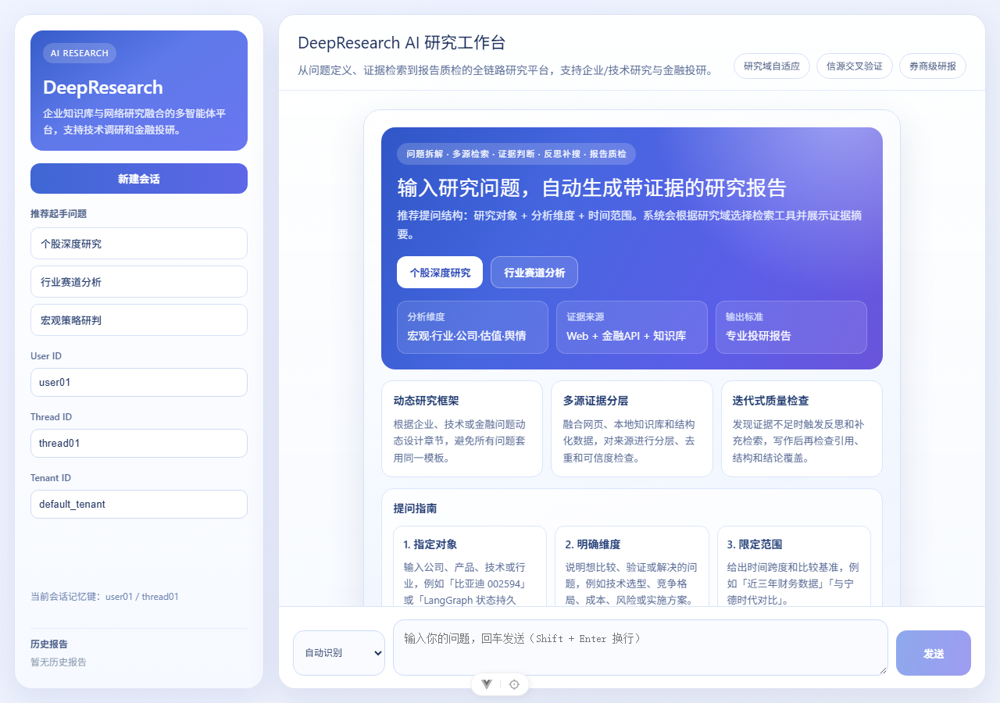

# DeepResearch

> 企业知识库 + 网络研究融合的多智能体研究平台

[](https://www.python.org/)
[](https://fastapi.tiangolo.com/)
[](https://langchain-ai.github.io/langgraph/)
[](https://vuejs.org/)
[](https://www.docker.com/)

DeepResearch 是一个面向企业知识研究、技术调研和金融投研的 AI 应用。它将联网搜索、本地知识库检索、结构化数据源和多智能体协作结合起来，输出带证据、可追溯、可评估的研究报告。

项目适合用于展示 AI 应用开发、RAG、Agent Workflow、FastAPI 服务化、SSE 流式响应、Docker 部署和上线维护能力。

## 前端界面



前端支持研究域选择、研究过程展示、报告历史、证据摘要和 Markdown 报告下载。

## 主要能力

- **双研究域**：支持 `general` 企业/技术研究和 `finance` 金融投研，`auto` 模式可根据问题自动识别领域。
- **多智能体研究流程**：规划、检索、证据判断、分析、反思、补充检索、写作和质量检查协同完成任务。
- **混合检索**：同时支持网络搜索、本地文件/知识库 RAG，以及可选的 AKShare 金融数据源。
- **证据可追溯**：报告保留来源编号、引用覆盖检查、证据统计、高置信度证据数量和研究轨迹。
- **迭代式研究**：质量检查发现证据不足时，可以继续补充检索，避免一次检索直接生成结论。
- **实时交互**：提供普通调用和 SSE 流式接口，前端可以展示当前研究阶段和进度。
- **报告管理**：支持报告 ID、历史记录、用量统计、质量结果和研究元数据查询；默认以本地 JSONL 持久化，便于单机运行和迁移。
- **可上线维护**：包含认证、限流、健康检查、Docker Compose、CI、测试、评估集、日志和部署维护文档。

## 系统架构

```text
┌──────────────────────┐
│ Vue 3 Web Frontend   │
│ domain / progress /  │
│ report / history     │
└──────────┬───────────┘
           │ REST + SSE
┌──────────▼───────────┐
│ FastAPI API Layer    │
│ auth / rate limit /  │
│ validation / history │
└──────────┬───────────┘
           │
┌──────────▼─────────────────────────────────┐
│ LangGraph Research Workflow                │
│ planner → parallel retrieval → evidence    │
│ judge → analyst → reflection → writer      │
│ → quality check → supplementary research   │
└───────┬──────────────┬──────────────┬──────┘
        │              │              │
┌───────▼──────┐ ┌─────▼─────┐ ┌──────▼──────┐
│ Web Search   │ │ Local RAG │ │ Finance API │
│ Bocha/other  │ │ Milvus    │ │ AKShare    │
└──────────────┘ └───────────┘ └─────────────┘
        │
┌───────▼─────────────────────────────────────┐
│ Memory/checkpoint: PostgreSQL / Redis      │
│ Reports: local JSONL; vectors: Milvus      │
└─────────────────────────────────────────────┘
```

核心代码入口：

- `app/app_main.py`：FastAPI 应用入口。
- `app/backend/router/`：研究、历史和健康检查接口。
- `app/backend/service/workflow_service.py`：工作流服务、报告元数据和流式事件。
- `app/mult_agents/graph.py`：LangGraph 工作流编排。
- `app/mult_agents/nodes.py`：各研究节点和质量检查逻辑。
- `app/mult_agents/research_profile.py`：研究领域识别与领域策略。
- `app/mult_agents/rag/`：知识库和检索能力。

## 快速开始

### 1. 本地运行后端

Windows PowerShell：

```powershell
git clone https://github.com/chirt39/deep-research-.git
cd deep-research-

python -m venv .venv
.\.venv\Scripts\Activate.ps1
pip install -r requirements.txt

Copy-Item .env.example .env
# 编辑 .env，至少配置 DEEPSEEK_API_KEY

python -m uvicorn app.app_main:app --host 127.0.0.1 --port 8000
```

后端启动后可访问：

- Swagger：<http://localhost:8000/docs>
- 健康检查：<http://localhost:8000/health>

### 2. 本地运行前端

另开终端：

```powershell
cd front/agent_front
npm ci
npm run dev
```

前端默认地址：<http://localhost:5173>

### 3. Docker Compose 部署

适合本地完整运行和后续部署到 Linux 服务器：

```powershell
Copy-Item .env.example .env
# 修改 .env 中的 DEEPSEEK_API_KEY、POSTGRES_PASSWORD、AUTH_TOKEN
docker compose up -d --build
docker compose ps
```

基础设施服务默认只暴露在 Compose 内部网络，避免 PostgreSQL、Redis、Milvus 直接暴露到公网。生产环境建议在前面增加 Caddy 或 Nginx，并配置 HTTPS。

## API 示例

### 发起研究

`POST /api/v1/research/run`

```json
{
  "query": "调研 LangGraph 的状态持久化和断点恢复机制",
  "research_domain": "general",
  "user_id": "user_001",
  "thread_id": "session_001",
  "tenant_id": "default_tenant",
  "max_iterations": 2,
  "enable_memory": false
}
```

金融问题可以指定：

```json
{
  "query": "分析某行业的竞争格局、景气度和主要风险",
  "research_domain": "finance"
}
```

响应中包含以下关键字段：

```json
{
  "final": "研究报告正文",
  "research_domain": "general",
  "report_id": "report_xxx",
  "usage": {},
  "quality": {},
  "evidence_summary": {},
  "trace": []
}
```

### 接口列表

| 方法 | 路径 | 说明 |
|---|---|---|
| `GET` | `/health` | 服务和依赖健康检查 |
| `POST` | `/api/v1/research/run` | 同步执行研究任务 |
| `POST` | `/api/v1/research/stream` | SSE 流式执行研究任务 |
| `GET` | `/api/v1/research/history` | 查询报告历史 |
| `GET` | `/api/v1/research/history/{report_id}` | 查询单份报告详情 |

如果配置了 `AUTH_TOKEN`，API 请求需要携带认证信息：

```http
Authorization: Bearer <AUTH_TOKEN>
```

## 研究域策略

| 模式 | 适用场景 | 输出重点 |
|---|---|---|
| `auto` | 不确定研究类型 | 根据问题关键词自动识别 |
| `general` | 企业、技术、产品、方案调研 | 结论、背景、方案、对比、风险和实施建议 |
| `finance` | 宏观、行业、公司、资产研究 | 宏观、行业、基本面、估值、情绪、风险和投资观察 |

`general` 模式不会强行生成投资评级或目标价；`finance` 模式在依赖可用时可以使用 AKShare 等金融数据源。模型生成内容仍应经过人工复核，不能直接作为投资建议或生产决策依据。

## 配置说明

复制 `.env.example` 为 `.env` 后按需配置：

| 变量 | 用途 |
|---|---|
| `DEEPSEEK_API_KEY` | DeepSeek 模型调用密钥 |
| `DEEPSEEK_MODEL` | 使用的模型名称 |
| `DEEPSEEK_BASE_URL` | 模型服务地址 |
| `BOCHA_API_KEY` | 网络搜索服务密钥 |
| `AUTH_TOKEN` | API Bearer Token；生产环境建议开启 |
| `RATE_LIMIT_PER_MINUTE` | 单用户/服务限流阈值 |
| `ENABLE_MILVUS` | 是否启用 Milvus 知识库 |
| `ENABLE_MEMORY` | 是否启用长期记忆 |
| `CHECKPOINTER_BACKEND` | 内存、Redis 或 PostgreSQL 检查点后端 |
| `REDIS_URL` | Redis 地址 |
| `POSTGRES_DSN` | PostgreSQL 连接串 |
| `MILVUS_HOST` / `MILVUS_PORT` | Milvus 地址和端口 |
| `LLM_AS_JUDGE` | 是否启用 LLM 质量评估 |

不要将真实密钥提交到 Git。`.env` 已被忽略，提交前请检查 `git status` 和敏感信息扫描结果。

## 测试与评估

```powershell
# 后端测试
python -m pytest -q

# Python 编译检查
python -m compileall -q app scripts

# 前端生产构建
cd front/agent_front
npm run build-only
cd ../..

# Docker Compose 配置检查
docker compose --env-file .env.example config --quiet

# 使用评估集检查一份报告
python scripts/evaluate_report.py `
  --case evals/cases.jsonl `
  --case-id general-rag-001 `
  --report path/to/report.md
```

当前仓库包含：

- 单元测试和接口测试：`tests/`。
- 研究任务评估样例：`evals/cases.jsonl`。
- 报告评估脚本：`scripts/evaluate_report.py`。
- CI 配置：`.github/workflows/`。

建议上线前持续记录以下指标：成功率、平均耗时、每份报告 Token/费用、引用覆盖率、证据置信度、用户反馈和人工纠错率。

## 文档导航

- [文档目录与导航](docs/00-目录与导航.md)
- [架构总览与配置](docs/01-架构总览与配置.md)
- [工作流与智能体](docs/02-工作流与智能体.md)
- [知识库系统](docs/06-知识库系统.md)
- [企业研究模式与改造设计](docs/11-企业研究模式与改造设计.md)
- [上线维护与评估](docs/12-上线维护与评估.md)
- [面试准备手册](docs/10-面试准备手册.md)

## 生产部署建议

单机部署可以从 4 核 CPU、8 GB 内存起步，根据并发和向量库规模扩容。推荐的上线步骤：

1. 使用 Docker Compose 启动应用和基础设施。
2. 通过 Caddy/Nginx 提供 HTTPS 和域名访问。
3. 应用服务、PostgreSQL、Redis、Milvus 分离备份策略。
4. 配置容器自动重启、健康检查、日志轮转和磁盘告警。
5. 定期备份报告历史、知识库元数据和 PostgreSQL 数据。
6. 使用评估集和线上指标监控检索质量、引用质量和成本。

详细的上线、回滚、备份、故障排查和迭代计划见 [上线维护与评估](docs/12-上线维护与评估.md)。

## 项目定位

这个项目不是只调用一次大模型的问答 Demo，而是一个可解释、可追踪、可评估和可维护的研究型 AI 应用：

- 用 LangGraph 表达复杂任务状态和节点依赖。
- 用 RAG 和来源证据降低无依据生成。
- 用质量检查和补充检索形成闭环。
- 用 FastAPI、SSE、Docker 和监控思路支撑服务化落地。

## License

当前仓库尚未提交独立的许可证文件。明确许可证前，请不要将本项目作为可再分发的软件包使用；第三方模型、搜索服务、数据源和开源组件仍需遵守其各自的服务条款与许可证。
